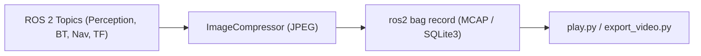

# tools-robot_recorder

[](https://docs.ros.org/en/humble/) [](LICENSE) [](mailto:teamrobontu@gmail.com)

Record what the robot saw and thought, then replay it or turn it into a video:
camera (as JPEG), every perception output and debug overlay, speech and
behaviour-tree state, scheduler status, and the map / costmap / TF / lidar side.

ROS package: `robot_recorder`.


## Architecture



## I. Requirements

- ROS 2 Humble with `ros2 bag` (zstd plugin is part of the default install)
- `python3-opencv`, `python3-numpy`
- Recommended on the robot: `sudo apt install ros-humble-rosbag2-storage-mcap` (tested: picked up
  automatically, zstd chunks, Foxglove-native).
  Bags are then MCAP with zstd chunk compression, which is smaller and opens directly in Foxglove.
  Without it, bags are plain sqlite3 (`.db3`), which Foxglove also opens.

## II. Setup & Installation

Install Python dependencies:
```bash
pip install -r requirements.txt
```

```bash
cd ~/ros2_ws
colcon build --packages-select robot_recorder
source install/setup.bash
```

## III. How to Run

Record on the machine with the camera, so images are compressed before they cross the LAN:

```bash
~/ros2_ws/src/tools-robot_recorder/record.sh                   # until Ctrl-C, into ~/bags/
ros2 run robot_recorder record --name receptionist_try3 --duration 120
ros2 run robot_recorder record --depth --audio                 # also raw depth + the continuous mic stream
ros2 run robot_recorder record --config my_groups.yaml         # override topic regex groups from YAML
ros2 run robot_recorder record --list                          # which current topics would be recorded
```

Replay (on another `ROS_DOMAIN_ID` if the real robot is running, so replayed and live topics don't mix):

```bash
ROS_DOMAIN_ID=42 ros2 run robot_recorder play ~/bags/<bag> [--loop] [--rate 0.5] [--start 30]
```

Or open the bag folder's `.mcap` / `.db3` in **Foxglove** with no ROS at all: Image panels for the
camera and debug overlays, a 3D panel for TF, costmap, map and point clouds.

Straight to a video file:

```bash
ros2 run robot_recorder export_video ~/bags/<bag>                                         # lists image streams
ros2 run robot_recorder export_video ~/bags/<bag> /perception/debug/person_face/image/compressed -o face.mp4
```

The `/perception/debug/*` streams already have the perception overlays drawn in, so they are the
quickest "robot view" video.

## IV. ROS 2 Topics & Messages

### What gets recorded

Selected by regex, so topics that appear after recording started are picked up too:

| Group | Topics | Default |
| :--- | :--- | :--- |
| camera | `/camera/**`: head_d455 and the wrist left_d405/right_d405, colour as `<topic>/compressed` (JPEG), `camera_info` | on |
| perception | `/perception/**` (people, faces, poses, seats, filtered lidar, debug images as JPEG) | on |
| hri | `/speech/**` (incl. the audio of each utterance), `/audio/doorbell*`, `/robot_face/**`, `/conversation_llm/**`, `/behaviour_tree/**`, `/core/scheduler/status`, `/rosout` | on |
| nav | `/tf`, `/tf_static`, `/map*`, `*costmap*`, `/scan*`, `/odom*`, `/amcl_pose`, `/cmd_vel*`, `/motion_target/**` (chassis commands), `/hdas/feedback_chassis*`/`_torso*`, `*plan` (`/plan`, `/local_plan`), `/goal_pose`, `*/_action/status`, `*marker*`, `/semantic_boxes*`, `/robot_description`, `/joint_states`, `/lidar_filter/**`, `/battery_state` | on |
| depth | `*depth*` (raw 16-bit, about 18-25 MB/s per stream) | `--depth` |
| audio | `/audio/chunks` (continuous mic, about 64 KB/s) | `--audio` |
| lidar_raw | `/livox/**`, `/hdas/lidar*` (point clouds, several MB/s each). `/perception/lidar/points_nav` and `points_filtered` are already in perception | `--lidar-raw` |

Never recorded: raw colour images (unless `--raw-images`), `/parameter_events`, action feedback internals.
Add anything else with `--extra '<regex>'`, or pass `--config <file.yaml>` to override the default groups in `robot_recorder/groups.py`.

### Published while recording

| Topic | Type | Rate / QoS | Description |
| :--- | :--- | :--- | :--- |
| `<image topic>/compressed` | `sensor_msgs/msg/CompressedImage` | up to `--image-fps` (10) / same reliability as the camera | JPEG (`--jpeg-quality` 80) of each raw colour image in the camera/perception groups. Skipped when the camera already publishes `/compressed`. Keeps the original header stamp. |

## V. Repository Structure

```
tools-robot_recorder/
  record.sh                       # sources ROS + workspace, then ros2 run robot_recorder record "$@"
  robot_recorder/
    robot_recorder/
      record.py                   # starts compressor + ros2 bag record, writes robot_view_info.yaml
      groups.py                   # what gets recorded (regex groups)
      image_compressor.py         # raw Image -> <topic>/compressed JPEG
      play.py                     # ros2 bag play with --clock
      export_video.py             # compressed image stream -> MP4
    test/test_groups.py
```

## VI. Technical Explanation

- **Size:** a raw 640x480 colour stream is about 9 MB/s (27 MB/s for the D455 at 30 Hz). As JPEG at
  quality 80 and 10 fps it is about 0.3-0.5 MB/s, so a 10-minute run with two image streams is
  roughly 0.5 GB instead of 10+ GB.
- **Reliability:** the compressor subscribes with the same reliability as the camera. A best-effort
  subscription to a reliable publisher drops big frames, because a ~1 MB image is many UDP
  fragments and losing one loses the frame.
- **Splitting:** a new bag file every `--split` seconds (300), so a crash or power cut loses at most
  that much.
- **`robot_view_info.yaml`** in each bag records the host, ROS domain, options, the regexes used, and
  the branch@commit of every repo in `$ROBOHOME_WS_SRC` (default `~/ros2_ws/src`), with a note when a repo had uncommitted
  changes. So you can tell later which code produced a recording.
- `--zstd` compresses a sqlite3 bag further, but then only `ros2 bag play` and `export_video` can read
  it, not Foxglove. MCAP storage gets compression without that trade-off.

## VII. References

- rosbag2: https://github.com/ros2/rosbag2
- Foxglove: https://docs.foxglove.dev/docs/visualization/panels/image

---

## Contributors

- **Khiem Nguyen** (`@KhiemGOM`)

Maintained by **Nanyang Technological University Team Robo** (`teamrobontu@gmail.com`).

## License

Licensed under the [Apache License 2.0](LICENSE).
